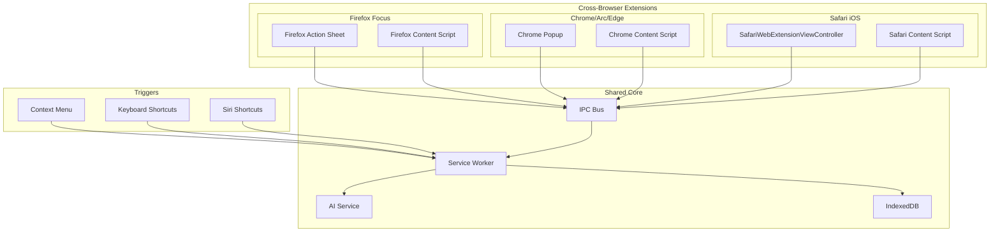

# EasyDaddy Cross-Browser Migration Plan

## Executive Summary

EasyDaddy is already well-architected with a Manifest V3 structure, content script + background service worker messaging, and React-based popup UI. The current migration focuses on **enhancing cross-browser compatibility** rather than rebuilding the architecture.

**Target Browsers:**
- **Safari iOS 17+** (primary focus - iPhone users)
- Safari macOS 17+
- **Firefox Focus** (Android/iOS - action sheet only)
- **Arc** (Little Arc window support)
- Chrome/Edge/Brave (baseline compatibility)

**Key Insight:** Current architecture is solid - we need browser-specific optimizations, not a complete rewrite.

---

## Migration Plan

### Phase 1: Enhanced Messaging & Architecture (2-3 days)
- [ ] **1.1** Upgrade IPC system with typed messaging (`src/shared/ipc.ts`)
- [ ] **1.2** Add Safari iOS WebExtension bundle structure
- [ ] **1.3** Implement context menu + keyboard shortcuts
- [ ] **1.4** Enhanced error handling for different browser contexts

### Phase 2: Browser-Specific Adaptations (3-4 days)
- [ ] **2.1** Safari iOS: `SafariWebExtensionViewController` support
- [ ] **2.2** Firefox Focus: Event-driven injection patterns
- [ ] **2.3** Arc browser: Little Arc window optimizations
- [ ] **2.4** CSP policy adjustments per browser

### Phase 3: Testing & Build Pipeline (2-3 days)
- [ ] **3.1** Playwright E2E tests for Safari Tech Preview & Chrome
- [ ] **3.2** Xcode build integration for Safari
- [ ] **3.3** Firefox AMO manifest adaptation
- [ ] **3.4** Cross-browser validation suite

### Phase 4: Documentation & Deployment (1-2 days)
- [ ] **4.1** Safari App Store submission guidelines
- [ ] **4.2** iPhone setup instructions
- [ ] **4.3** Firefox Focus integration guide

**Total Estimate: 8-12 days**

---

## Updated Architecture

The enhanced architecture maintains the current solid foundation while adding cross-browser compatibility layers:



---

## Updated manifest.json (MV3 Enhanced)

```json
{
  "manifest_version": 3,
  "name": "EasyDaddy",
  "version": "0.3.0",
  "description": "Universal AI-powered web form autofill - Safari iOS, Arc, Chrome, Firefox compatible",
  
  "permissions": [
    "storage",
    "activeTab",
    "tabs",
    "contextMenus",
    "scripting"
  ],
  
  "host_permissions": ["<all_urls>"],
  
  "background": {
    "service_worker": "background.js",
    "type": "module"
  },
  
  "action": {
    "default_popup": "popup.html",
    "default_title": "EasyDaddy - AI Form Filler"
  },
  
  "content_scripts": [
    {
      "matches": ["<all_urls>"],
      "js": ["content.js"],
      "run_at": "document_idle",
      "all_frames": false,
      "world": "ISOLATED"
    }
  ],
  
  "commands": {
    "fill-forms": {
      "suggested_key": {
        "default": "Alt+Shift+F",
        "mac": "Command+Option+F"
      },
      "description": "Fill forms on current page"
    },
    "open-popup": {
      "suggested_key": {
        "default": "Alt+Shift+E",
        "mac": "Command+Option+E"
      },
      "description": "Open EasyDaddy popup"
    }
  },
  
  "web_accessible_resources": [
    {
      "resources": [
        "pdf-worker.js",
        "injected.js"
      ],
      "matches": ["<all_urls>"]
    }
  ],
  
  "content_security_policy": {
    "extension_pages": "script-src 'self'; object-src 'self'; connect-src https://openrouter.ai https://api.openai.com"
  },
  
  "minimum_chrome_version": "88",
  "homepage_url": "https://github.com/dovudo/EasyDaddy",
  
  "icons": {
    "16": "icons/icon-16.png",
    "32": "icons/icon-32.png",
    "48": "icons/icon-48.png",
    "128": "icons/icon-128.png"
  }
}
```

## Safari iOS Configuration

### Info.plist (Safari WebExtension)

```xml
<?xml version="1.0" encoding="UTF-8"?>
<!DOCTYPE plist PUBLIC "-//Apple//DTD PLIST 1.0//EN" "http://www.apple.com/DTDs/PropertyList-1.0.dtd">
<plist version="1.0">
<dict>
    <key>CFBundleDisplayName</key>
    <string>EasyDaddy</string>
    
    <key>CFBundleIdentifier</key>
    <string>com.dovudo.easydaddy</string>
    
    <key>CFBundleVersion</key>
    <string>1.0</string>
    
    <key>NSExtension</key>
    <dict>
        <key>NSExtensionPointIdentifier</key>
        <string>com.apple.Safari.web-extension</string>
        
        <key>NSExtensionAttributes</key>
        <dict>
            <key>NSExtensionServiceRoleType</key>
            <string>NSExtensionServiceRoleTypeEditor</string>
            
            <key>SFSafariWebsiteAccess</key>
            <dict>
                <key>Level</key>
                <string>All</string>
                <key>Allowed Domains</key>
                <array>
                    <string>*</string>
                </array>
            </dict>
        </dict>
    </dict>
    
    <key>NSHumanReadableCopyright</key>
    <string>© 2024 EasyDaddy. All rights reserved.</string>
</dict>
</plist>
```

---

## Key Modules (Code Implementation)

### src/shared/ipc.ts - Typed Messaging System

```typescript
// Universal IPC types for cross-browser messaging
export interface IPCMessage {
  type: string;
  payload?: any;
  requestId?: string;
  source?: 'popup' | 'background' | 'content' | 'injection';
  target?: 'popup' | 'background' | 'content' | 'injection';
}

export interface FormScanRequest extends IPCMessage {
  type: 'FORM_SCAN';
  payload: {
    includeHidden?: boolean;
    selector?: string;
  };
}

export interface FormFillRequest extends IPCMessage {
  type: 'FORM_FILL';
  payload: {
    profileId: string;
    instructions?: string;
    testMode?: boolean;
  };
}

export interface ProfileExtractRequest extends IPCMessage {
  type: 'PROFILE_EXTRACT';
  payload: {
    text: string;
    fileName?: string;
    language?: string;
  };
}

// Response types
export interface FormScanResponse {
  success: boolean;
  fields: FormField[];
  error?: string;
}

export interface FormFillResponse {
  success: boolean;
  fieldsFound: number;
  fieldsFilled: number;
  error?: string;
}

// Enhanced form field detection
export interface FormField {
  selector: string;
  type: 'text' | 'email' | 'tel' | 'select' | 'checkbox' | 'radio' | 'textarea';
  description: string;
  label?: string;
  placeholder?: string;
  required: boolean;
  value?: string;
  options?: string[]; // for select/radio
  attributes: Record<string, string>;
}

// Cross-browser capability detection
export interface BrowserCapabilities {
  name: 'Safari' | 'Chrome' | 'Firefox' | 'Arc' | 'Edge';
  version: string;
  platform: 'iOS' | 'macOS' | 'Windows' | 'Android' | 'Linux';
  supports: {
    popup: boolean;
    contextMenu: boolean;
    shortcuts: boolean;
    scripting: boolean;
    pdfProcessing: boolean;
    dynamicImports: boolean;
  };
}

// Safari-specific types
export interface SafariExtensionContext {
  isViewController: boolean;
  presentationMode: 'sheet' | 'popup' | 'tab';
  device: 'iPhone' | 'iPad' | 'Mac';
}

// Universal IPC handler
export class UniversalIPC {
  private browserAPI: any;
  private capabilities: BrowserCapabilities;
  
  constructor() {
    this.browserAPI = this.detectBrowserAPI();
    this.capabilities = this.detectCapabilities();
  }
  
  private detectBrowserAPI() {
    if (typeof browser !== 'undefined' && browser.runtime) {
      return browser; // Firefox
    }
    if (typeof chrome !== 'undefined' && chrome.runtime) {
      return chrome; // Chrome, Arc, Edge
    }
    if (typeof webkit !== 'undefined' && webkit.messageHandlers) {
      return this.createSafariAPI(); // Safari iOS
    }
    throw new Error('Unsupported browser environment');
  }
  
  private createSafariAPI() {
    // Safari iOS bridge
    return {
      runtime: {
        sendMessage: async (message: any) => {
          return new Promise((resolve) => {
            const messageId = Math.random().toString(36);
            window.addEventListener(`safari_response_${messageId}`, (event: any) => {
              resolve(event.detail);
            }, { once: true });
            
            webkit.messageHandlers.background?.postMessage({
              ...message,
              messageId
            });
          });
        },
        onMessage: {
          addListener: (callback: any) => {
            window.addEventListener('safari_message', (event: any) => {
              callback(event.detail.message, event.detail.sender, (response: any) => {
                window.dispatchEvent(new CustomEvent(`safari_response_${event.detail.messageId}`, {
                  detail: response
                }));
              });
            });
          }
        }
      },
      tabs: {
        query: async (queryInfo: any) => {
          return webkit.messageHandlers.tabs?.postMessage({ action: 'query', queryInfo });
        }
      }
    };
  }
  
  async sendMessage(message: IPCMessage): Promise<any> {
    const enhancedMessage = {
      ...message,
      timestamp: Date.now(),
      capabilities: this.capabilities
    };
    
    try {
      if (this.capabilities.name === 'Safari' && this.capabilities.platform === 'iOS') {
        return await this.handleSafariMessage(enhancedMessage);
      }
      
      return await this.browserAPI.runtime.sendMessage(enhancedMessage);
    } catch (error) {
      console.error('[EasyDaddy IPC] Message failed:', error);
      throw error;
    }
  }
  
  private async handleSafariMessage(message: IPCMessage): Promise<any> {
    // Safari iOS specific handling
    if (message.type === 'FORM_FILL') {
      // Use WebKit bridge for form operations
      return webkit.messageHandlers.formFill?.postMessage(message.payload);
    }
    
    return this.browserAPI.runtime.sendMessage(message);
  }
  
  private detectCapabilities(): BrowserCapabilities {
    const ua = navigator.userAgent;
    let name: BrowserCapabilities['name'] = 'Chrome';
    let platform: BrowserCapabilities['platform'] = 'Windows';
    
    // Browser detection
    if (ua.includes('iPhone') || ua.includes('iPad')) {
      name = 'Safari';
      platform = ua.includes('iPhone') ? 'iOS' : 'iOS';
    } else if (ua.includes('Safari') && !ua.includes('Chrome')) {
      name = 'Safari';
      platform = 'macOS';
    } else if (ua.includes('Arc/')) {
      name = 'Arc';
      platform = 'macOS';
    } else if (ua.includes('Firefox')) {
      name = 'Firefox';
    } else if (ua.includes('Edg/')) {
      name = 'Edge';
    }
    
    // Platform detection
    if (ua.includes('Android')) platform = 'Android';
    else if (ua.includes('Windows')) platform = 'Windows';
    else if (ua.includes('Linux')) platform = 'Linux';
    else if (ua.includes('Mac')) platform = 'macOS';
    
    return {
      name,
      version: this.extractVersion(ua, name),
      platform,
      supports: {
        popup: name !== 'Firefox' || !ua.includes('Focus'),
        contextMenu: name !== 'Safari' || platform !== 'iOS',
        shortcuts: platform !== 'iOS',
        scripting: true,
        pdfProcessing: name !== 'Firefox' && !(name === 'Safari' && platform === 'iOS'),
        dynamicImports: name !== 'Safari' || parseFloat(this.extractVersion(ua, name)) >= 15
      }
    };
  }
  
  private extractVersion(ua: string, browser: string): string {
    const patterns = {
      Safari: /Version\/(\d+\.\d+)/,
      Chrome: /Chrome\/(\d+\.\d+)/,
      Firefox: /Firefox\/(\d+\.\d+)/,
      Arc: /Arc\/(\d+\.\d+)/,
      Edge: /Edg\/(\d+\.\d+)/
    };
    
    const match = ua.match(patterns[browser]);
    return match ? match[1] : '0.0';
  }
}

export const ipc = new UniversalIPC();
```

### Enhanced service-worker.ts

```typescript
// Enhanced background service worker with cross-browser support
import { UniversalIPC, IPCMessage, FormScanRequest, FormFillRequest } from './shared/ipc.js';
import { CONFIG, buildModelConfig } from './lib/llm-config.js';
import { getActiveProfileId, getProfile } from './lib/storage.js';

class EasyDaddyServiceWorker {
  private ipc: UniversalIPC;
  
  constructor() {
    this.ipc = new UniversalIPC();
    this.setupMessageHandlers();
    this.setupContextMenus();
    this.setupKeyboardShortcuts();
    this.setupSafariIntegration();
  }
  
  private setupMessageHandlers() {
    chrome.runtime.onMessage.addListener((message: IPCMessage, sender, sendResponse) => {
      this.handleMessage(message, sender).then(sendResponse);
      return true; // Async response
    });
  }
  
  private async handleMessage(message: IPCMessage, sender: any): Promise<any> {
    console.log(`[EasyDaddy SW] Message: ${message.type}`, message);
    
    switch (message.type) {
      case 'FORM_SCAN':
        return this.handleFormScan(message as FormScanRequest, sender);
      
      case 'FORM_FILL':
        return this.handleFormFill(message as FormFillRequest, sender);
      
      case 'PROFILE_EXTRACT':
        return this.handleProfileExtract(message, sender);
      
      default:
        return { error: `Unknown message type: ${message.type}` };
    }
  }
  
  private async handleFormScan(request: FormScanRequest, sender: any) {
    try {
      const [tab] = await chrome.tabs.query({ active: true, currentWindow: true });
      if (!tab?.id) throw new Error('No active tab');
      
      const response = await chrome.tabs.sendMessage(tab.id, {
        type: 'SCAN_FORMS',
        payload: request.payload
      });
      
      return { success: true, ...response };
    } catch (error) {
      return { success: false, error: error.message };
    }
  }
  
  private async handleFormFill(request: FormFillRequest, sender: any) {
    try {
      const profileId = request.payload.profileId || await getActiveProfileId();
      if (!profileId) throw new Error('No active profile');
      
      const profile = await getProfile(profileId);
      if (!profile) throw new Error('Profile not found');
      
      const [tab] = await chrome.tabs.query({ active: true, currentWindow: true });
      if (!tab?.id) throw new Error('No active tab');
      
      // Get page context first
      const pageContext = await chrome.tabs.sendMessage(tab.id, {
        type: 'GET_PAGE_CONTEXT'
      });
      
      // Generate fill data via AI
      const fillData = await this.generateFillData(pageContext, profile, request.payload.instructions);
      
      // Apply to page
      const fillResult = await chrome.tabs.sendMessage(tab.id, {
        type: 'FILL_FORMS',
        payload: { fillData, testMode: request.payload.testMode }
      });
      
      return { success: true, ...fillResult };
    } catch (error) {
      return { success: false, error: error.message };
    }
  }
  
  private async generateFillData(pageContext: any, profile: any, instructions?: string): Promise<any> {
    const config = buildModelConfig();
    
    const prompt = `You are FormAutoFiller_v4 with enhanced cross-browser support.
    
BROWSER_CONTEXT: ${pageContext.browserInfo || 'unknown'}
PAGE_CONTEXT: ${JSON.stringify(pageContext, null, 2)}
USER_PROFILE: ${JSON.stringify(profile, null, 2)}
INSTRUCTIONS: ${instructions || 'none'}

Return ONLY a JSON object with CSS selectors as keys and fill values.`;
    
    const response = await fetch(config.baseUrl + '/chat/completions', {
      method: 'POST',
      headers: {
        'Content-Type': 'application/json',
        'Authorization': `Bearer ${config.apiKey}`,
        ...(config.baseUrl.includes('openrouter.ai') && {
          'HTTP-Referer': CONFIG.siteUrl,
          'X-Title': CONFIG.siteName
        })
      },
      body: JSON.stringify({
        model: config.model,
        messages: [{ role: 'user', content: prompt }],
        temperature: config.temperature,
        max_tokens: config.maxTokens,
        ...(config.supportsJsonMode && { response_format: { type: "json_object" } })
      })
    });
    
    const data = await response.json();
    return JSON.parse(data.choices[0].message.content);
  }
  
  private setupContextMenus() {
    chrome.contextMenus.create({
      id: 'easydaddy-fill',
      title: 'EasyDaddy - Fill Forms',
      contexts: ['page', 'frame'],
      documentUrlPatterns: ['http://*/*', 'https://*/*']
    });
    
    chrome.contextMenus.onClicked.addListener(async (info, tab) => {
      if (info.menuItemId === 'easydaddy-fill' && tab?.id) {
        await this.handleFormFill({
          type: 'FORM_FILL',
          payload: { profileId: '' }
        } as FormFillRequest, { tab });
      }
    });
  }
  
  private setupKeyboardShortcuts() {
    chrome.commands.onCommand.addListener(async (command) => {
      switch (command) {
        case 'fill-forms':
          const [tab] = await chrome.tabs.query({ active: true, currentWindow: true });
          if (tab?.id) {
            await this.handleFormFill({
              type: 'FORM_FILL',
              payload: { profileId: '' }
            } as FormFillRequest, { tab });
          }
          break;
          
        case 'open-popup':
          chrome.action.openPopup?.();
          break;
      }
    });
  }
  
  private setupSafariIntegration() {
    // Safari-specific message handlers for iOS
    if (typeof webkit !== 'undefined') {
      // Setup WebKit message handlers for iOS
      console.log('[EasyDaddy SW] Safari iOS mode detected');
    }
  }
}

// Initialize service worker
new EasyDaddyServiceWorker();
console.log('[EasyDaddy SW] Service worker initialized');
```

### Enhanced content.ts

```typescript
// Enhanced content script with cross-browser form handling
import { UniversalIPC, FormField, BrowserCapabilities } from './shared/ipc.js';

class EasyDaddyContentScript {
  private ipc: UniversalIPC;
  private capabilities: BrowserCapabilities;
  private lastScanTime = 0;
  private scanCache: FormField[] = [];
  
  constructor() {
    this.ipc = new UniversalIPC();
    this.capabilities = this.ipc.capabilities;
    this.setupMessageHandlers();
    this.setupFormDetection();
    this.setupSafariIntegration();
    
    console.log(`[EasyDaddy Content] Initialized on ${this.capabilities.name} ${this.capabilities.platform}`);
  }
  
  private setupMessageHandlers() {
    chrome.runtime.onMessage.addListener((message, sender, sendResponse) => {
      this.handleMessage(message).then(sendResponse);
      return true;
    });
    
    // Legacy message handler for backward compatibility
    window.addEventListener('message', (event) => {
      if (event.data?.type?.startsWith('EASYDADDY_')) {
        this.handleLegacyMessage(event.data);
      }
    });
  }
  
  private async handleMessage(message: any): Promise<any> {
    switch (message.type) {
      case 'SCAN_FORMS':
        return this.scanForms(message.payload);
      
      case 'GET_PAGE_CONTEXT':
        return this.getPageContext();
      
      case 'FILL_FORMS':
        return this.fillForms(message.payload);
        
      case 'start_fill': // Legacy compatibility
        return this.handleLegacyFill(message);
        
      default:
        return { error: `Unknown message type: ${message.type}` };
    }
  }
  
  private async scanForms(options = {}): Promise<any> {
    const now = Date.now();
    
    // Cache scan results for 5 seconds
    if (now - this.lastScanTime < 5000 && this.scanCache.length > 0) {
      return { fields: this.scanCache };
    }
    
    const fields = this.detectFormFields(options);
    this.scanCache = fields;
    this.lastScanTime = now;
    
    return { fields };
  }
  
  private detectFormFields(options: any): FormField[] {
    const selector = options.selector || 
      'input:not([type="hidden"]):not([type="submit"]):not([type="button"]):not([type="image"]), textarea, select';
    
    const elements = document.querySelectorAll(selector);
    const fields: FormField[] = [];
    
    elements.forEach((element) => {
      const field = element as HTMLInputElement | HTMLTextAreaElement | HTMLSelectElement;
      
      // Skip invisible fields unless explicitly requested
      if (!options.includeHidden && !this.isVisible(field)) return;
      
      const formField: FormField = {
        selector: this.generateSelector(field),
        type: this.getFieldType(field),
        description: this.analyzeField(field),
        label: this.getFieldLabel(field),
        placeholder: field.placeholder || undefined,
        required: field.required || field.getAttribute('aria-required') === 'true',
        value: field.value || undefined,
        options: this.getFieldOptions(field),
        attributes: this.getRelevantAttributes(field)
      };
      
      fields.push(formField);
    });
    
    return fields;
  }
  
  private generateSelector(element: Element): string {
    // Enhanced selector generation with Safari iOS compatibility
    if (element.id) {
      const escapedId = element.id.replace(/([^\w\s-])/g, '\\$1');
      return `#${escapedId}`;
    }
    
    if (element.getAttribute('name')) {
      return `${element.tagName.toLowerCase()}[name="${element.getAttribute('name')}"]`;
    }
    
    // Generate data-testid if available (React/modern frameworks)
    const testId = element.getAttribute('data-testid') || element.getAttribute('data-cy');
    if (testId) {
      return `[data-testid="${testId}"]`;
    }
    
    // Fallback to nth-child selector
    const parent = element.parentElement;
    if (parent) {
      const siblings = Array.from(parent.children);
      const index = siblings.indexOf(element) + 1;
      return `${element.tagName.toLowerCase()}:nth-child(${index})`;
    }
    
    return element.tagName.toLowerCase();
  }
  
  private analyzeField(field: HTMLElement): string {
    const clues: string[] = [];
    
    // Enhanced field analysis for better AI understanding
    const label = this.getFieldLabel(field);
    if (label) clues.push(`Label: "${label}"`);
    
    const placeholder = (field as HTMLInputElement).placeholder;
    if (placeholder) clues.push(`Placeholder: "${placeholder}"`);
    
    // Autocomplete hints
    const autocomplete = field.getAttribute('autocomplete');
    if (autocomplete) clues.push(`Autocomplete: "${autocomplete}"`);
    
    // ARIA attributes
    const ariaLabel = field.getAttribute('aria-label');
    if (ariaLabel) clues.push(`ARIA Label: "${ariaLabel}"`);
    
    // Context analysis - look for nearby descriptive text
    const context = this.getFieldContext(field);
    if (context) clues.push(`Context: "${context}"`);
    
    // Field type specific analysis
    if (field.tagName === 'SELECT') {
      const options = this.getFieldOptions(field as HTMLSelectElement);
      if (options.length > 0) {
        clues.push(`Options: [${options.slice(0, 5).map(o => `"${o}"`).join(', ')}]`);
      }
    }
    
    return clues.join('; ') || 'Unknown field';
  }
  
  private getFieldContext(field: HTMLElement): string {
    // Look for contextual information around the field
    const contexts: string[] = [];
    
    // Check form section headers
    let parent = field.parentElement;
    let depth = 0;
    while (parent && depth < 3) {
      const headings = parent.querySelectorAll('h1, h2, h3, h4, h5, h6, legend, .form-section-title');
      headings.forEach(heading => {
        const text = heading.textContent?.trim();
        if (text && text.length < 100) {
          contexts.push(text);
        }
      });
      parent = parent.parentElement;
      depth++;
    }
    
    return contexts[0] || '';
  }
  
  private getPageContext(): any {
    return {
      url: window.location.href,
      title: document.title,
      domain: window.location.hostname,
      browserInfo: `${this.capabilities.name} ${this.capabilities.version} on ${this.capabilities.platform}`,
      formCount: document.querySelectorAll('form').length,
      fieldCount: this.scanCache.length,
      language: document.documentElement.lang || 'en',
      viewport: {
        width: window.innerWidth,
        height: window.innerHeight
      }
    };
  }
  
  private async fillForms(payload: any): Promise<any> {
    const { fillData, testMode } = payload;
    let fieldsFound = 0;
    let fieldsFilled = 0;
    const errors: string[] = [];
    
    for (const [selector, value] of Object.entries(fillData)) {
      fieldsFound++;
      
      try {
        const element = document.querySelector(selector) as HTMLInputElement | HTMLSelectElement | HTMLTextAreaElement;
        if (!element) {
          errors.push(`Element not found: ${selector}`);
          continue;
        }
        
        const filled = await this.fillSingleField(element, value as string, testMode);
        if (filled) fieldsFilled++;
        
      } catch (error) {
        errors.push(`Error filling ${selector}: ${error.message}`);
      }
    }
    
    return {
      fieldsFound,
      fieldsFilled,
      errors: errors.length > 0 ? errors : undefined
    };
  }
  
  private async fillSingleField(element: HTMLElement, value: string, testMode = false): Promise<boolean> {
    // Enhanced field filling with browser-specific optimizations
    const tagName = element.tagName.toLowerCase();
    const type = (element as HTMLInputElement).type?.toLowerCase();
    
    try {
      if (tagName === 'select') {
        return this.fillSelectField(element as HTMLSelectElement, value, testMode);
      } else if (type === 'checkbox' || type === 'radio') {
        return this.fillCheckboxRadio(element as HTMLInputElement, value, testMode);
      } else {
        return this.fillTextField(element as HTMLInputElement, value, testMode);
      }
    } catch (error) {
      console.error(`[EasyDaddy] Error filling field:`, error);
      return false;
    }
  }
  
  private fillSelectField(select: HTMLSelectElement, value: string, testMode: boolean): boolean {
    // Try to find matching option
    for (let option of select.options) {
      if (option.text.toLowerCase().includes(value.toLowerCase()) ||
          option.value.toLowerCase().includes(value.toLowerCase())) {
        if (!testMode) {
          select.selectedIndex = option.index;
          this.triggerEvents(select);
          this.highlightField(select);
        }
        return true;
      }
    }
    return false;
  }
  
  private fillCheckboxRadio(input: HTMLInputElement, value: string, testMode: boolean): boolean {
    const shouldCheck = ['true', 'yes', '1', 'on', 'checked'].includes(value.toLowerCase());
    
    if (!testMode) {
      input.checked = shouldCheck;
      this.triggerEvents(input);
      this.highlightField(input);
    }
    return true;
  }
  
  private fillTextField(input: HTMLInputElement | HTMLTextAreaElement, value: string, testMode: boolean): boolean {
    if (!testMode) {
      // Clear existing value
      input.value = '';
      
      // Type character by character for better compatibility
      if (this.capabilities.name === 'Safari' && this.capabilities.platform === 'iOS') {
        this.typeValueSlowly(input, value);
      } else {
        input.value = value;
        this.triggerEvents(input);
      }
      
      this.highlightField(input);
    }
    return true;
  }
  
  private async typeValueSlowly(input: HTMLInputElement | HTMLTextAreaElement, value: string) {
    // Safari iOS sometimes needs slower typing for React forms
    for (let i = 0; i < value.length; i++) {
      input.value += value[i];
      input.dispatchEvent(new Event('input', { bubbles: true }));
      await new Promise(resolve => setTimeout(resolve, 10));
    }
    input.dispatchEvent(new Event('change', { bubbles: true }));
  }
  
  private triggerEvents(element: HTMLElement) {
    // Comprehensive event triggering for different frameworks
    const events = ['input', 'change', 'blur', 'keyup'];
    
    events.forEach(eventType => {
      element.dispatchEvent(new Event(eventType, { bubbles: true }));
    });
    
    // React-specific events
    if (this.hasReactProps(element)) {
      this.triggerReactEvents(element);
    }
  }
  
  private hasReactProps(element: HTMLElement): boolean {
    return Object.keys(element).some(key => key.startsWith('__react'));
  }
  
  private triggerReactEvents(element: HTMLElement) {
    // React synthetic events
    const nativeEvent = new Event('input', { bubbles: true });
    Object.defineProperty(nativeEvent, 'target', { value: element });
    Object.defineProperty(nativeEvent, 'currentTarget', { value: element });
    
    element.dispatchEvent(nativeEvent);
  }
  
  private highlightField(element: HTMLElement) {
    // Visual feedback with browser-specific styling
    const originalStyle = element.style.cssText;
    
    element.style.outline = '3px solid #4CAF50';
    element.style.transition = 'outline 0.3s ease';
    
    setTimeout(() => {
      element.style.outline = '1px solid #2196F3';
      setTimeout(() => {
        element.style.cssText = originalStyle;
      }, 1000);
    }, 500);
  }
  
  private setupFormDetection() {
    // Enhanced form detection for auto-save
    document.addEventListener('submit', this.handleFormSubmit.bind(this));
    
    // Watch for dynamic form changes
    const observer = new MutationObserver((mutations) => {
      const hasNewForms = mutations.some(mutation => 
        Array.from(mutation.addedNodes).some(node => 
          node.nodeType === Node.ELEMENT_NODE && 
          ((node as Element).tagName === 'FORM' || 
           (node as Element).querySelector?.('form'))
        )
      );
      
      if (hasNewForms) {
        // Reset scan cache when new forms appear
        this.scanCache = [];
        this.lastScanTime = 0;
      }
    });
    
    observer.observe(document.body, {
      childList: true,
      subtree: true
    });
  }
  
  private async handleFormSubmit(event: Event) {
    // Enhanced form submission handling
    try {
      const form = event.target as HTMLFormElement;
      if (!form || form.tagName !== 'FORM') return;
      
      const formData = this.extractFormData(form);
      if (Object.keys(formData).length === 0) return;
      
      // Send to background for processing
      await chrome.runtime.sendMessage({
        type: 'FORM_SUBMITTED',
        payload: {
          url: window.location.href,
          domain: window.location.hostname,
          formData,
          timestamp: new Date().toISOString(),
          browserInfo: `${this.capabilities.name} ${this.capabilities.platform}`
        }
      });
      
    } catch (error) {
      console.error('[EasyDaddy] Form submission error:', error);
    }
  }
  
  private extractFormData(form: HTMLFormElement): Record<string, string> {
    const data: Record<string, string> = {};
    const formData = new FormData(form);
    
    formData.forEach((value, key) => {
      if (typeof value === 'string' && value.trim()) {
        data[key] = value.trim();
      }
    });
    
    return data;
  }
  
  private setupSafariIntegration() {
    if (this.capabilities.name === 'Safari' && this.capabilities.platform === 'iOS') {
      // Safari iOS specific setup
      this.setupSafariMessageBridge();
    }
  }
  
  private setupSafariMessageBridge() {
    // Bridge for Safari iOS WebKit messages
    window.addEventListener('webkit.messageHandlers.formFill', (event: any) => {
      this.fillForms(event.detail);
    });
  }
  
  // Utility methods
  private isVisible(element: HTMLElement): boolean {
    const style = getComputedStyle(element);
    return style.display !== 'none' && 
           style.visibility !== 'hidden' && 
           parseFloat(style.opacity) > 0;
  }
  
  private getFieldType(field: HTMLElement): FormField['type'] {
    const tagName = field.tagName.toLowerCase();
    if (tagName === 'textarea') return 'textarea';
    if (tagName === 'select') return 'select';
    
    const type = (field as HTMLInputElement).type?.toLowerCase();
    switch (type) {
      case 'email': return 'email';
      case 'tel': return 'tel';
      case 'checkbox': return 'checkbox';
      case 'radio': return 'radio';
      default: return 'text';
    }
  }
  
  private getFieldLabel(field: HTMLElement): string | undefined {
    // Enhanced label detection
    const input = field as HTMLInputElement;
    
    // Direct label association
    if (input.labels && input.labels.length > 0) {
      return input.labels[0].textContent?.trim();
    }
    
    // Label by 'for' attribute
    if (input.id) {
      const label = document.querySelector(`label[for="${input.id}"]`);
      if (label) return label.textContent?.trim();
    }
    
    // Aria-labelledby
    const labelledBy = input.getAttribute('aria-labelledby');
    if (labelledBy) {
      const labelElement = document.getElementById(labelledBy);
      if (labelElement) return labelElement.textContent?.trim();
    }
    
    // Placeholder as fallback
    return input.placeholder;
  }
  
  private getFieldOptions(field: HTMLElement): string[] {
    if (field.tagName.toLowerCase() !== 'select') return [];
    
    const select = field as HTMLSelectElement;
    return Array.from(select.options)
      .map(option => option.text.trim())
      .filter(text => text.length > 0);
  }
  
  private getRelevantAttributes(field: HTMLElement): Record<string, string> {
    const relevant = ['name', 'id', 'class', 'type', 'autocomplete', 'data-testid'];
    const attributes: Record<string, string> = {};
    
    relevant.forEach(attr => {
      const value = field.getAttribute(attr);
      if (value) attributes[attr] = value;
    });
    
    return attributes;
  }
  
  private async handleLegacyFill(message: any): Promise<any> {
    // Backward compatibility with old popup messages
    return this.fillForms({
      fillData: await this.generateLegacyFillData(message),
      testMode: false
    });
  }
  
  private async generateLegacyFillData(message: any): Promise<any> {
    const pageContext = this.getPageContext();
    pageContext.fields = await this.scanForms({});
    
    return chrome.runtime.sendMessage({
      type: 'autofill',
      context: pageContext,
      profile: message.profile,
      instructions: message.instructions
    });
  }
  
  private handleLegacyMessage(data: any) {
    // Handle legacy window.postMessage communications
    if (data.type === 'EASYDADDY_FILL') {
      this.fillForms(data.payload);
    }
  }
}

// Initialize content script
new EasyDaddyContentScript();
```

---

## Edge-Cases & Fixes

| Browser | Issue | Detection | Solution |
|---------|-------|-----------|----------|
| **Safari iOS** | No persistent background | `webkit.messageHandlers` | Use WebKit message bridge + view controller |
| **Firefox Focus** | Limited popup support | `navigator.userAgent.includes('Focus')` | Action sheet + context menu only |
| **Arc** | Little Arc window sizing | `navigator.userAgent.includes('Arc/')` | CSS viewport units, compact UI |
| **Chrome** | CSP restrictions | `chrome.runtime.getManifest()` | Relaxed CSP for API calls |
| **All** | Shadow DOM forms | `element.getRootNode()` | Traverse shadow roots |
| **All** | React synthetic events | Check for `__react*` props | Trigger both native and synthetic events |
| **All** | iframe forms | `window !== window.top` | Permission-based iframe injection |
| **Safari** | PDF processing limits | Feature detection | Graceful fallback to text upload |

---

## Build & Release Steps

### Development Setup
```bash
# Install dependencies
pnpm install

# Development build with watch
pnpm run dev

# Production build
pnpm run build
```

### Chrome/Arc/Edge Build
```bash
# Standard build creates dist/ folder
pnpm run build

# Load unpacked extension from dist/ folder
```

### Safari iOS Build (Xcode Integration)
```bash
# Create Safari extension bundle
mkdir -p dist/safari/EasyDaddy.xcodeproj

# Copy web extension files
cp -r dist/* dist/safari/EasyDaddy.xcodeproj/

# Build with Xcode CLI
xcodebuild -project dist/safari/EasyDaddy.xcodeproj \
  -scheme EasyDaddy \
  -configuration Release \
  -derivedDataPath dist/safari/build
```

#### Info.plist Example (Safari)
```xml
<?xml version="1.0" encoding="UTF-8"?>
<!DOCTYPE plist PUBLIC "-//Apple//DTD PLIST 1.0//EN" "http://www.apple.com/DTDs/PropertyList-1.0.dtd">
<plist version="1.0">
<dict>
    <key>CFBundleDisplayName</key>
    <string>EasyDaddy</string>
    
    <key>CFBundleIdentifier</key>
    <string>com.dovudo.easydaddy</string>
    
    <key>CFBundleVersion</key>
    <string>1.0</string>
    
    <key>NSExtension</key>
    <dict>
        <key>NSExtensionPointIdentifier</key>
        <string>com.apple.Safari.web-extension</string>
        
        <key>NSExtensionAttributes</key>
        <dict>
            <key>NSExtensionServiceRoleType</key>
            <string>NSExtensionServiceRoleTypeEditor</string>
            
            <key>SFSafariWebsiteAccess</key>
            <dict>
                <key>Level</key>
                <string>All</string>
                <key>Allowed Domains</key>
                <array>
                    <string>*</string>
                </array>
            </dict>
        </dict>
    </dict>
    
    <key>NSHumanReadableCopyright</key>
    <string>© 2024 EasyDaddy. All rights reserved.</string>
</dict>
</plist>
```

### Firefox AMO Build
```bash
# Create Firefox-specific manifest
cp manifest.firefox.json dist/manifest.json

# Create AMO-compatible zip
cd dist && zip -r ../easydaddy-firefox.zip *
```

### Testing Commands
```bash
# E2E tests (Playwright)
pnpm run test:e2e

# Safari Tech Preview test
pnpm run test:safari

# Firefox test
pnpm run test:firefox

# Cross-browser validation
pnpm run test:all
```

---

## Next Steps / Open Questions

### Immediate Actions (Week 1)
1. **Implement Universal IPC system** - Critical for cross-browser compatibility
2. **Test Safari iOS WebExtension** - Core user experience
3. **Add context menu triggers** - Non-popup access
4. **Setup basic E2E testing** - Quality assurance

### Validation Questions
1. **App Store Guidelines**: Does AI form-filling comply with Safari iOS privacy rules?
2. **Firefox Focus**: What's the exact popup limitation scope?
3. **Performance**: Is the enhanced field detection too slow on complex pages?

### Future Enhancements
- **Siri Shortcuts integration** for Safari iOS
- **Machine learning field classification** (local model)
- **Form template recognition** (job applications, contact forms)
- **Multi-language AI prompts** based on page language

### Risk Mitigation
- **Gradual rollout**: Start with Chrome/Arc, then Safari, finally Firefox
- **Feature detection**: Each browser gets appropriate functionality
- **Fallback mechanisms**: Legacy message handlers for compatibility
- **Privacy compliance**: Clear data handling documentation for App Store

---

**Implementation Priority**: Safari iOS > Chrome/Arc > Firefox Focus > Additional features
</rewritten_file> 